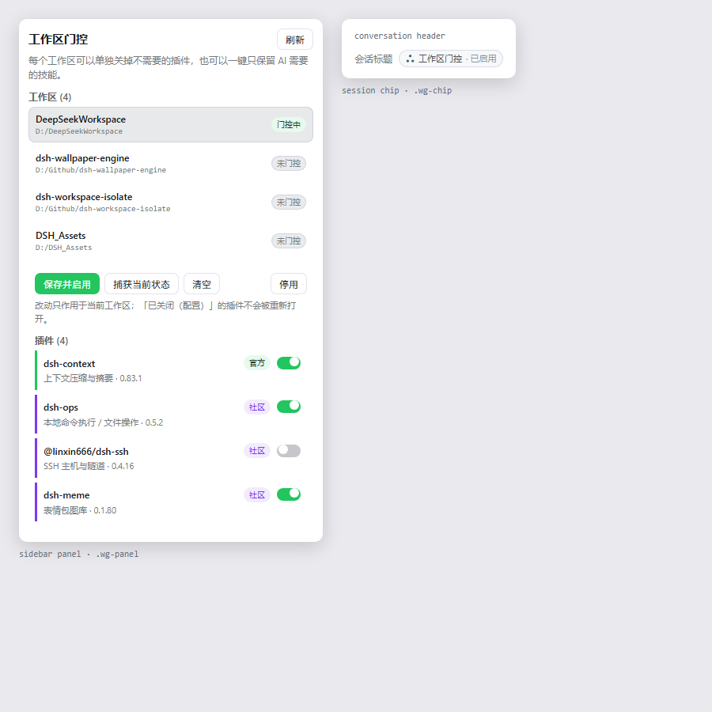

# @cyberyui/dsh-workspace-isolate

[](https://github.com/CyberYui/dsh-workspace-isolate/actions/workflows/verify.yml)
[](https://github.com/CyberYui/dsh-workspace-isolate/actions/workflows/issue-claim-policy.yml)
[](LICENSE)

每个工作区一份独立的插件与技能开关：在这个工作区关掉的插件，只在这个工作区关掉。

## 它解决什么

DSH 的插件是**按 profile 全局加载**的：`cordis.patch.yml` 里写 `disabled: true`，所有工作区一起失效。
于是「写代码的工作区只想要 5 个插件」和「另一个工作区要全部插件」只能二选一——要么全局关掉，
要么全局开着然后忍受用不到的插件占内存、抢快捷键、把技能塞进上下文。

这个插件把开关的粒度降到**工作区**：

- 侧边栏面板里选一个工作区，勾掉这个工作区不需要的插件，保存并启用。
- 开关是**实时**的：直接改 loader 条目，不写 `cordis.patch.yml`，不需要重启。
- 会话标题栏有一个小 chip，显示当前会话所属工作区的门控状态，点它可以在弹窗里快速切换。

## 界面



> 上图是按 `client.js` 的 DOM 结构与 `PANEL_CSS` / `CHIP_CSS` 样式令牌 1:1 复刻的**静态预览**，
> 不是运行截图（DSH 的界面在 Electron 渲染进程里，需要登录态才能截）。数据为示例。

- **侧边栏面板**：跨工作区管理。工作区列表、每个工作区的插件/技能开关、「保存并启用 / 捕获当前状态 / 清空 / 停用」。
- **会话 chip**：跟随当前会话所属工作区，只读展示 + 快速开关。
- **外观卡片**：面板顶部一个 0–100% 的滑杆，实时预览本插件的表面不透明度（见下一节）。

## 安装

```bash
dsh plugin add @cyberyui/dsh-workspace-isolate --profile desktop
```

或把 `"@cyberyui/dsh-workspace-isolate"` 加进 profile 的 `package.json` 的 `dsh.profile.bundles`，
再跑一次 `pnpm install`。

装完需要**重启 DSH**：插件的 `cordis.patch.yml` 只在 profile 加载时读取。

## 语义：哪些开关不会生效

插件有几条刻意的保守规则，理解它们比记住按钮更重要：

| 情形 | 行为 | 原因 |
| --- | --- | --- |
| 内置插件（`dsh-base` / `dsh-web-app` / 本插件） | 永远不可关 | 关掉会让宿主起不来 |
| 你在 `protectIds` 里声明的 id | 不可关 | 给「这个工作区必须留 X」用 |
| 被别的插件依赖的服务 | 关不掉，面板里显示阻塞者 | 避免关出半个坏掉的插件链 |
| `cordis.patch.yml` 里已经 `disabled: true` 的插件 | 面板标「已关闭（配置）」，**也不会被重新打开** | profile 的意图优先于工作区策略 |
| 有 Agent 正在运行时启用门控 | 返回 409，提示稍后再试 | 不在别人跑一半的时候抽插件 |
| 策略里的 id 在插件升级后已不存在 | 面板顶部红条提示数量 | 不让你以为还关着 |

最后一条是安全功能的一部分：**策略静默失配会被显示出来**，而不是假装生效。

## 外观：表面不透明度

装了 wallpaper 引擎之后，玻璃配方会在 `body[data-we-glass-page]` 上改写 `--dsw-alias-bg-layer-*`，
本插件的面板、chip 与浮层会跟着变成「玻璃片」——背景透出花纹、文字压在上面看不清。
所以本插件把不透明度**收回自己手里**，而不是继承宿主的玻璃配方：

- **基色** `--we-panel-color`：不透明的主题面（浅色纯白、深色 `rgb(35,35,36)`）。
- **釉色** `--we-surface-tint-light` / `--we-surface-tint-dark`：你在 wallpaper 里选的那个玻璃色。
- **浓度** `--wg-surface-opacity`：本插件面板上的滑杆，0..1，默认 **0.85**。

视觉效果仍然跟随你的玻璃色与玻璃开关（和设置窗、侧栏同源），但可读性由本插件自己兜住。

滑杆的端点语义是刻意的：

| 位置 | 结果 |
| --- | --- |
| 0% | 表面**完全透明**——面板/chip/浮层的底消失，只剩文字与边框 |
| 100% | 表面**完全不透明**——纯色面，完全不透壁纸 |
| 中间 | 单调过渡，釉色占比随浓度缩放 |

拖动时只改本地与 CSS（实时预览），**松手 / 回车 / 失焦才落盘**，所以拖一圈不会写一百次文件。
值存在状态文件里，**实时生效，不需要重启 DSH**。

这个设置**不在** `cordis.patch.yml` 的配置里：它属于运行时状态，真值只有一处（状态文件），
避免「配置写 85、状态写 60」这种两处真值。

## 配置

`dsh` 段（写在 profile 的插件配置里）：

```yaml
gatingEnabled: true      # 总开关
protectIds: []           # 额外受保护的 loader id / 包名
dataFile: ''             # 留空 = <home>/dsh-workspace-isolate/workspaces.json
```

状态文件是普通 JSON，可以直接看、可以手改（改完在面板里刷新即可）：

```
C:/Users/<you>/.dsh/dsh-workspace-isolate/workspaces.json
```

里面除了各工作区的开关，还有一个 `surfaceOpacity`（0–100 的整数）。手写也行，
但超出范围的值会在读取时被钳回 0–100，非数字则保留默认 85。

## 开发

零运行时依赖，没有构建步骤。

```bash
node --check index.js client.js                  # 语法
node .github/scripts/repo-hygiene.mjs verify    # 结构 + 回归标记门禁
node test/host-regression.mjs                    # 行为回归（B1–B11）
node test/css-invariants.mjs                     # 玻璃适配样式回归（8 组不变量）
npm test                                         # 上面两个回归一起跑
```

`test/host-regression.mjs` 用临时目录和假 loader 覆盖十一类回归，不碰真实 profile、不需要 DSH 在跑。
`repo-hygiene.mjs verify` 额外检查这些修复的回归标记还在，防止有人删掉修复后测试跟着改绿。
`test/css-invariants.mjs` 盯住玻璃适配的三套旧方案（`--wg-wash`、`--we-readability-floor`、
`(1 - var(--wg-surface-opacity`）不要回来——那三次都是真实翻车，改动原因写在脚本头部。

### 改完之后

插件装在三处：本仓库、`D:/DSH_Assets/DSH_Plugins/dsh-workspace-isolate`、profile 的
`node_modules/@cyberyui/dsh-workspace-isolate`。**只改本仓库**，另外两份由维护者用
`D:/DeepSeekWorkspace/scripts/preflight.mjs` 比对 sha1 后同步。

## CI

`verify.yml`：`changes`（变更分类，拿不到基线就全量，fail-closed）→ `plugin`（Ubuntu + Windows
跑 hygiene + 行为回归 + 样式回归）/ `docs` → `result`（`ci/result`，总是运行）。
分支保护只勾 `ci/result`。

`plugin` 的矩阵是 `runs-on: ${{ matrix.os }}` + `os: [ubuntu-latest, windows-latest]`，
两格都会跑：客户端 `client.js` 里既有 `documentElement` 也有 `fetch`，Windows 与 Linux 都要过。

## 发布

包名 `@cyberyui/dsh-workspace-isolate`，走 **npm**（DSH 插件市场从 npm 装，不看 GitHub Releases）。

- **手动**：仓库根目录 `npm publish --access public`（需 npm 登录）。
- **CI**：推 `v*` 标签触发 `.github/workflows/publish.yml`，或 Actions 页面手动 Run workflow。

npm 将在 **2027 年 1 月**移除「bypass-2FA 令牌直接发布新版本」的能力（classic token 已在
2025-12-09 全部吊销），所以发布主路径改成 **OIDC 可信发布**：

1. 在 npmjs.com → 该包 → Settings → **Trusted Publisher** 加一条：
   Organization or user = `CyberYui`，Repository = `dsh-workspace-isolate`，
   Workflow filename = `publish.yml`。
2. 之后推 `v*` 标签，CI 用 OIDC 短期凭证发布，不需要长期 npm token。
   workflow 里的 `NODE_AUTH_TOKEN` 只是兜底 secret，可以不设。

要求 npm CLI ≥ 11.5.1、Node ≥ 22.14.0；可信发布只支持 GitHub 托管 runner。

## 贡献

先读 [CONTRIBUTING.md](CONTRIBUTING.md)。要点：改行为先提 issue；外部贡献者走
`/assign` → `status:accepted` + `/approve @you` → 再开带 `Fixes #123` 的 PR。
`issue-claim-policy` 检查会拒绝「先开 PR 后补批准」，不合规会被自动关闭。

## 许可

MIT
